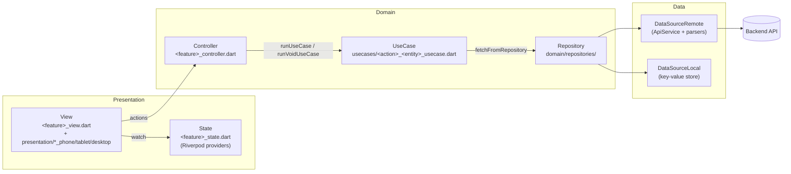
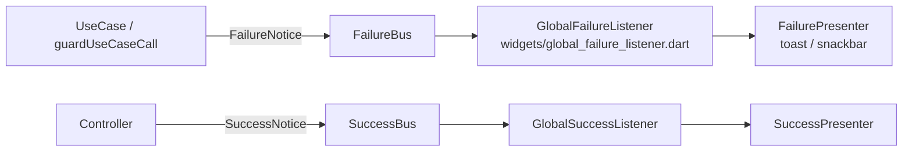
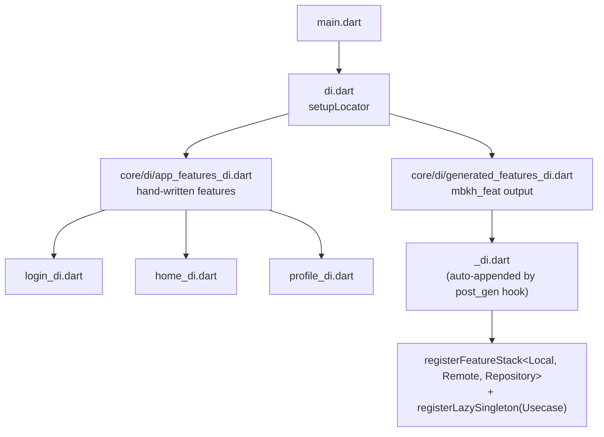

# Architecture Overview

Onboarding guide for `challingo`. The app is generated from the `mbkh_app` Mason brick and follows a strict layered, feature-first architecture.

## The big picture

Every screen follows the same one-way flow. Nothing skips a layer:



- **Views** only read providers and call controller methods. No business logic.
- **Controllers** orchestrate use cases via `runUseCase` / `runUseCaseOrNull` / `runVoidUseCase` (`core/helpers/use_case_runner.dart`). Never repositories or data sources directly.
- **UseCases** (one class per file) extend `RepositoryUseCase` / `RepositoryVoidUseCase` and return `Result<T>`.
- **Repositories** map data-source calls into `UseCaseResponse`s with `mapUseCaseResponse` / `mapUseCaseResponseVoid` — no per-method try/catch.
- **DataSources** are the only place that touches `ApiService` (remote) or storage (local). Responses are parsed with `RemoteResponseParser` (`parseBodyObjectOrNull`, `parseBodyListOrNull`).

## Request lifecycle

What happens when the user taps "Save":

```mermaid
sequenceDiagram
    participant View
    participant Controller
    participant UseCase
    participant Repository
    participant Remote as DataSourceRemote
    participant API as Backend

    View->>Controller: save()
    Controller->>UseCase: runUseCase(usecase, request)
    Note over UseCase: request.validate()
    UseCase->>Repository: fetchFromRepository(request)
    Repository->>Remote: editEntity(request)
    Remote->>API: POST { "Body": { "Token", "Request": {...} } }
    API-->>Remote: { "Body": { "Response": {...} } }
    Remote-->>Repository: Entity? (parsed)
    Repository-->>UseCase: EditEntityResponse
    UseCase-->>Controller: Result&lt;Entity&gt; (Ok / Err)
    Controller->>View: ref.invalidate(asyncEntityProvider)
```

Key conventions:

- Request payloads use the standard envelope via `Request.apiEnvelope({...})`.
- Entity `fromJson` uses `core/helpers/json_validators.dart` (`expectString`, `expectInt`, …) — never raw `json["Field"]`.
- After successful mutations, controllers `ref.invalidate(...)` the relevant async providers.

## Failure and success feedback

Errors never bubble to views manually — they flow through global buses:



- Silent loads: pass `emitFailures: false` / `notifyOnFailure: false`.
- Localized failure text: `context.localizeFailure(failure)` in views that render errors inline.
- Async screens use `AsyncProviderWidget` (loading → `LoadingWidget`, error → `TryAgainWidget`, data → content).

## Folder map

```text
lib/
├── main.dart              # bootstrap
├── app.dart               # MaterialApp.router + global listeners
├── di.dart                # GetIt root (locator)
├── core/
│   ├── navigation/        # app_route_names.dart, router_provider.dart (GoRouter)
│   ├── di/                # app_features_di.dart, generated_features_di.dart
│   ├── helpers/           # api_service, use_case_runner, parsers, validators…
│   ├── interfaces/        # base_usecase, base_repository, base_data_source…
│   ├── theme/             # app_colors.dart, app_theme.dart
│   ├── data/              # AppData (session/token)
│   └── extensions/        # context/date/string extensions
├── features/
│   └── <feature>/
│       ├── <feature>_view.dart          # responsive dispatcher
│       ├── <feature>_controller.dart
│       ├── <feature>_state.dart         # providers
│       ├── <feature>_di.dart            # register<Feature>Dependencies
│       ├── presentation/                # phone / tablet / desktop UIs
│       ├── usecases/                    # one usecase per file
│       └── domain/
│           ├── entities/                # fromJson via json_validators
│           ├── interfaces/              # data source + repository contracts
│           ├── repositories/
│           └── data_sources/            # remote (API) + local (cache)
└── widgets/               # shared UI kit (buttons, fields, admin kit, …)
```

## Dependency injection

`GetIt` is the service locator. Each feature registers its own stack:



`registerFeatureStack` names instances `<Feature>DataSourceRemote` / `<Feature>DataSourceLocal` and builds the repository via `<Feature>Repository.builder`.

## Code generation tooling

Three Mason bricks; their hooks keep wiring automatic:

| Brick | Generates | post_gen auto-wiring |
| --- | --- | --- |
| `mbkh_app` | Whole app skeleton (this project) | — |
| `mbkh_feat` | A feature module (view, controller, state, DI, domain stack, first usecase) | route constant, `GoRoute` entry, DI registrar (`// mbkh_feat:*` anchors) |
| `mbkh_usecase` | One usecase file for an existing feature | method in both interfaces, remote/local data sources, repository, DI registration (`// mbkh_usecase:*` anchors) |

Run both feature bricks from the app root with `-o .`. The anchor comments (`// mbkh_feat:...`, `// mbkh_usecase:...`) are insertion points — don't delete them.

## State management (Riverpod)

- Server-backed reads: `FutureProvider` / `FutureProvider.autoDispose`, named `async<Entity>Provider`.
- Route IDs: plain providers overridden per-route; derive async providers from them.
- Controllers return fetched models from `get/load` methods; don't store fetched models in mutable `StateProvider`.
- `AsyncNotifierProvider` only when the provider needs write methods mutating its own async state.
- After mutations: `ref.invalidate(...)`.

## Where to look next

- `WIRING_REQUIRED.md` — manual wiring fallback checklist (normally automated).
- `.cursor/rules/` — enforced conventions (architecture, naming, API contracts, DI checklist).
- `lib/widgets/` — shared UI kit; every widget has dartdoc describing its purpose.
- `unified_fields` package — form field styling/behavior, themed per app via `lib/widgets/inputs/challingo_field_decoration.dart`.
