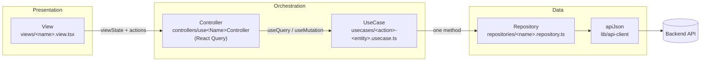
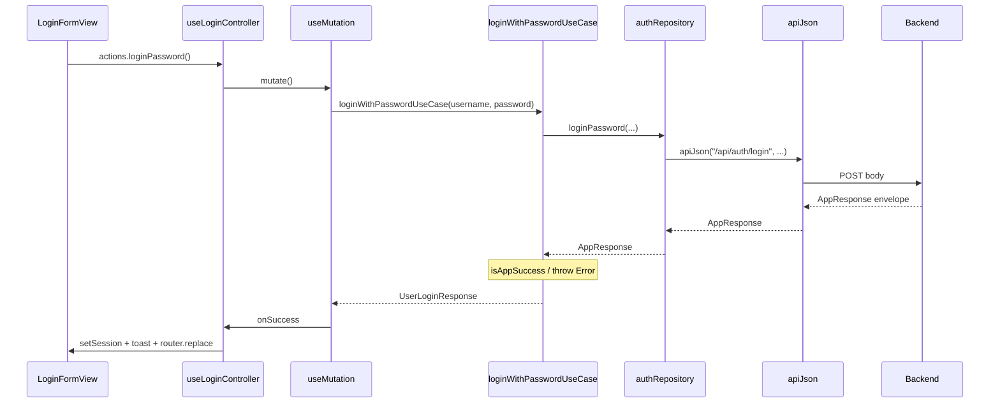
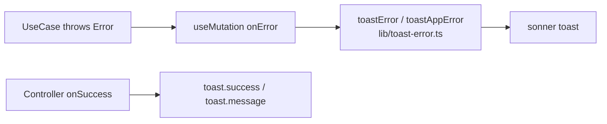

# Architecture Overview

Onboarding guide for the web app template. Features follow a strict layered, feature-first architecture that maps 1:1 onto the Flutter template's responsibilities (different names because React and Flutter build apps differently).

## The big picture

Every screen follows the same one-way flow. Nothing skips a layer:



- **Views** only read `viewState` / `pending` and call `actions.*`. No business logic, no repos, no use cases.
- **Controllers** (`"use client"` hooks) own transient UI state and orchestrate use cases via React Query. Never call repositories directly.
- **UseCases** (one function per file) call exactly one repository method, unwrap via `isAppSuccess` / `appErrorMessage`, and throw `Error` on failure.
- **Repositories** wrap `apiJson` only — "No business rules — transport only."
- **apiJson** / `lib/api-types.ts` parse the `AppResponse` envelope (`isAppSuccess`, `appErrorMessage`).

Reference features: `src/features/auth/`, `users/`, `roles/`, `organizations/`.

## Request lifecycle

What happens when the user signs in with a password:



Key conventions:

- After successful mutations, controllers `invalidateQueries` the relevant `queryKeys.*`.
- Controllers never import repositories; views never import use cases or React Query.

## Failure and success feedback

Errors never reach the view as raw API envelopes — they flow through the call stack:



This is deliberately simpler than Flutter's pub/sub `FailureBus` → `GlobalFailureListener` → `FailurePresenter`. React's call stack already gives you the equivalent of a bus for a single request — don't add an event-bus abstraction that isn't buying anything here.

- Silent loads: add a `silent?: boolean` param to the controller function rather than special-casing error handling per call site.
- Success feedback: `toast.success` / `toast.message` in the controller's `onSuccess`, not in the view.

## Folder map

```text
src/
├── app/                       # Next.js App Router (thin page wrappers)
├── components/                # shared UI (shadcn, layout shell, …)
├── config/                    # feature flags
├── features/
│   └── <feature>/
│       ├── views/             # presentational only
│       ├── controllers/       # useXController hooks + ViewModel types
│       ├── usecases/          # one usecase per file
│       ├── repositories/      # transport only (apiJson)
│       └── components/        # feature-local UI pieces (optional)
├── lib/                       # api-client, api-types, query-keys, toast-error, …
├── messages/                  # next-intl locales
└── stores/                    # client session state (zustand)
```

## Code generation tooling

Plain Node scripts (no Mason dependency), mirroring Flutter's `mbkh_feat` / `mbkh_usecase`:

| Script | Generates |
| --- | --- |
| `npm run generate:feature -- <kebab-name>` | `src/features/<name>/{repositories,usecases,controllers,views}/` |
| `npm run generate:usecase -- <feature> <action>` | One usecase file under that feature |

Generators print a manual checklist (query key, real endpoints, route wiring) — they do not auto-wire routes or `query-keys.ts` yet.

## Where to look next

- `.cursor/rules/` — enforced conventions (`web-feature-architecture.mdc`, one-usecase-per-file, query/error conventions, change quality gate, feature checklist).
- `scripts/generate-feature.mjs` / `scripts/generate-usecase.mjs` — scaffold new features in the right shape.
- `src/features/users/` — reference CRUD feature (also `roles/`, `organizations/`, `auth/`).
- `lib/query-keys.ts` — centralized React Query cache keys.
- `lib/toast-error.ts` — user-facing error toasts from thrown use-case errors.
